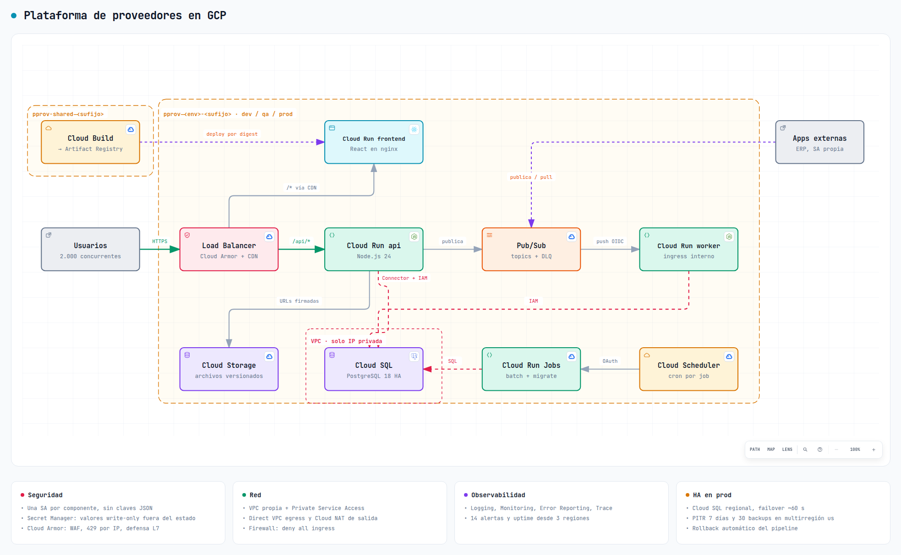
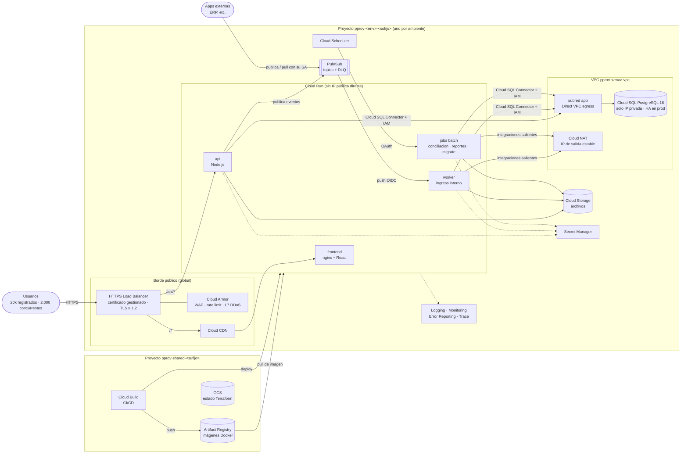
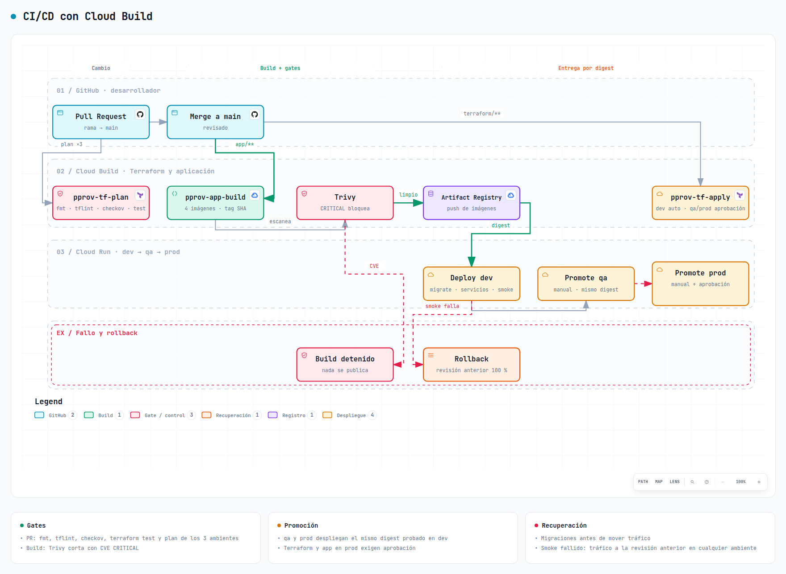
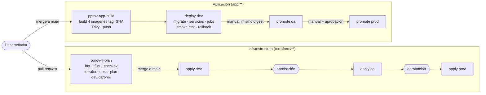

# Plataforma de proveedores en GCP

Infraestructura como código (Terraform) para una plataforma web de administración de proveedores,
pedidos y entregas. Incluye frontend React, API Node.js, base de datos relacional, archivos,
procesamiento asíncrono y batch, desplegada en tres ambientes (DEV, QA, PROD) con la **misma
definición** y **distinta configuración**.

| Entregable | Dónde |
|---|---|
| Terraform | [`terraform/`](terraform/): `bootstrap` (una vez), `platform` (por ambiente) y 9 módulos propios |
| Diagrama | Imágenes en [Arquitectura](#arquitectura) y [CI/CD](#cicd); interactivos en [arquitectura](https://jean9116.github.io/gapsi-test/docs/diagramas/arquitectura.html) y [CI/CD](https://jean9116.github.io/gapsi-test/docs/diagramas/cicd.html) (fuente JSON en `docs/diagramas/`) |
| Presupuesto años 1–3 | [`docs/presupuesto/`](docs/presupuesto/README.md), con el cálculo reproducible en `calcular.py` |
| Decisiones técnicas | [`docs/adr/`](docs/adr/), un ADR por decisión con alternativas y consecuencias |
| CI/CD | [`cicd/`](cicd/) (Cloud Build) y triggers en [`terraform/bootstrap/cicd.tf`](terraform/bootstrap/cicd.tf) |
| Aplicación de ejemplo | [`app/`](app/): 4 contenedores mínimos para probar la infraestructura de punta a punta |

## Índice

1. [Arquitectura](#arquitectura)
2. [Servicios GCP utilizados](#servicios-gcp-utilizados)
3. [Decisiones técnicas](#decisiones-técnicas)
4. [Prerrequisitos](#prerrequisitos)
5. [Configuración](#configuración)
6. [Despliegue](#despliegue)
7. [Variables](#variables)
8. [Ambientes](#ambientes)
9. [Seguridad](#seguridad)
10. [Observabilidad](#observabilidad)
11. [Recuperación](#recuperación)
12. [Destrucción](#destrucción)
13. [Reconstrucción](#reconstrucción)
14. [CI/CD](#cicd)
15. [Presupuesto](#presupuesto)
16. [Estructura del repositorio](#estructura-del-repositorio)

---

## Arquitectura



Versión interactiva (zoom, búsqueda, exportación): [https://jean9116.github.io/gapsi-test/docs/diagramas/arquitectura.html](https://jean9116.github.io/gapsi-test/docs/diagramas/arquitectura.html). Debajo, la misma vista en Mermaid.



**Flujo de una petición**: el usuario entra por el balanceador global. Cloud Armor filtra (WAF,
límite por IP). `/api/*` va a la API y el resto al frontend, servido desde la CDN. La API lee y
escribe en Cloud SQL por la VPC (IP privada, conector con mTLS e IAM), guarda archivos en GCS con
URLs firmadas y publica eventos en Pub/Sub. Pub/Sub los entrega al worker (push autenticado); las
apps externas publican y consumen sus propios topics. Cloud Scheduler lanza los jobs batch.

**Público y privado**:

| Componente | Exposición |
|---|---|
| Balanceador (IP global) | Público, único punto de entrada; HTTP redirige a HTTPS |
| frontend, api | `INGRESS_TRAFFIC_INTERNAL_LOAD_BALANCER`: la URL `*.run.app` no responde desde Internet |
| worker | `INGRESS_TRAFFIC_INTERNAL_ONLY` y solo lo invoca la SA `pubsub-push` |
| jobs | Sin ingress; solo los ejecutan Cloud Scheduler o el pipeline |
| Cloud SQL | Solo IP privada (Private Service Access), `ipv4_enabled = false` |
| Bucket de archivos | `public_access_prevention = enforced`; acceso por URLs firmadas de la API |
| VPC | Firewall que deniega toda entrada; salida a Internet solo por Cloud NAT |

---

## Servicios GCP utilizados

| Necesidad | Servicio | Por qué este |
|---|---|---|
| Runtime frontend | **Cloud Run** (nginx sin privilegios) | Contenedor estándar, escala a cero fuera de prod, sin servidores que mantener |
| Runtime API | **Cloud Run** | Autoescalado por concurrencia (80 peticiones/instancia), instancias mínimas en prod sin arranques en frío |
| Base de datos relacional | **Cloud SQL for PostgreSQL 18** (Enterprise) | Administrada, con HA regional, backups, PITR y autenticación IAM. AlloyDB costaría ~3 veces más |
| Archivos | **Cloud Storage** | Objetos versionados, ciclo de vida a Nearline, acceso por URLs firmadas |
| Asíncrono | **Pub/Sub** | Fan-out, reintentos con backoff, dead-letter, retención de 7 días; también sirve a las apps externas |
| Batch | **Cloud Run Jobs + Cloud Scheduler** | Misma imagen y modelo que los servicios; programado (cron) o bajo demanda |
| Registro privado | **Artifact Registry** | Tags inmutables, limpieza automática, acceso por IAM |
| Red | **VPC, subred, Private Service Access, Cloud NAT, Direct VPC egress** | Acceso privado a la BD y salida controlada sin conectores que pagar |
| Entrada | **External HTTPS LB + Cloud Armor + Cloud CDN** | Punto único con WAF, límite por IP, TLS gestionado y caché de estáticos |
| Secretos | **Secret Manager** | Inyectados como variables de entorno en Cloud Run; nunca en código ni en el estado |
| Identidad | **IAM + una service account por componente** | Mínimo privilegio por carga de trabajo |
| Observabilidad | **Cloud Logging, Monitoring, Error Reporting, Trace, Uptime checks** | Nativos, sin agentes; alertas por correo |
| CI/CD | **Cloud Build** (triggers de GitHub 2.ª gen) | Corre dentro de GCP con SAs propias: sin claves ni federación |
| Estado Terraform | **Cloud Storage** (versionado) | Bloqueo nativo, historial de versiones del estado |
| Control de gasto | **Cloud Billing Budgets** | Avisos al 50/90/100 % por proyecto |

---

## Decisiones técnicas

Cada decisión tiene su ADR con alternativas descartadas y consecuencias.

| ADR | Decisión | Alternativa descartada y motivo |
|---|---|---|
| [0001](docs/adr/0001-cloud-run-como-runtime.md) | Cloud Run para frontend, API, worker y batch | GKE Autopilot: clúster, upgrades y ~73 $/mes por ambiente que esta carga no necesita |
| [0002](docs/adr/0002-base-de-datos-privada.md) | Cloud SQL privado con conector e IAM; HA en prod | IP pública con redes autorizadas; AlloyDB por coste |
| [0003](docs/adr/0003-ambientes-y-estado.md) | Un proyecto por ambiente, un solo root y tfvars por ambiente | Workspaces (fácil aplicar sobre el ambiente equivocado); Terragrunt |
| [0004](docs/adr/0004-cicd-cloud-build.md) | Cloud Build con promoción del mismo digest, sin Cloud Deploy | Cloud Deploy duplicaría la especificación de Terraform |
| [0005](docs/adr/0005-asincronia-y-batch.md) | Pub/Sub push al worker con DLQ; Cloud Run Jobs para batch | Cloud Tasks (sin fan-out); Eventarc (capa extra sin valor aquí) |
| [0006](docs/adr/0006-borde-y-red.md) | LB global + Armor + CDN; servicios sin entrada directa | Exponer `run.app` directamente (sin WAF ni punto único) |
| [0007](docs/adr/0007-cifrado-y-escaneo.md) | Cifrado gestionado por Google; Trivy en el pipeline | CMEK (coste y operación sin requisito que lo pida); Artifact Analysis (~40 $/mes) |

Otras decisiones de dimensionamiento:

- **Capacidad**: 500k operaciones/día son ~6 op/s de media; con picos de ×10 y 2.000 concurrentes,
  la API de prod escala de 2 a 30 instancias de 80 peticiones cada una (hasta 2.400 simultáneas).
- **Conexiones a la BD**: `max_instances × pool por instancia` < `max_connections`. En prod,
  30 × 8 = 240 < 300. Cambiar uno obliga a revisar el otro.
- **Región**: `us-central1` por precio. Si los usuarios están en México, `northamerica-south1`
  (Querétaro) baja la latencia; es solo cambiar `region`.
- **Sin dominio propio**: se usa `<ip>.sslip.io`, que admite certificado gestionado. Con dominio,
  se define `domain` y un registro A a la IP del balanceador.

---

## Prerrequisitos

| Herramienta | Versión probada | Para qué |
|---|---|---|
| Terraform | ≥ 1.11 (probado con 1.16.6) | Valores *write-only* y recursos efímeros (secretos fuera del estado) |
| Google provider | `~> 8.0` (probado con 8.7.0) | — |
| gcloud CLI | reciente | Autenticación y operaciones puntuales |
| tflint, checkov | 0.64 / 3.3 | Calidad y seguridad (`make lint`, `make checkov`) |
| Docker | reciente | Solo para `make images` en local |
| GNU Make, bash | — | Atajos del repo |

En GCP:

- Una **cuenta de facturación** activa y permiso `billing.user` sobre ella.
- Organización **opcional**. Sin ella, el IAM se da proyecto a proyecto; con ella, se pasa
  `org_id` o `folder_id` al bootstrap.
- Cuotas por defecto bastan (4 proyectos nuevos).
- Para los triggers de CI/CD: el repositorio en GitHub y una **conexión de Cloud Build 2.ª gen**
  creada a mano una vez (requiere autorizar la app de GitHub en el navegador; no se puede hacer
  por Terraform).

Autenticación, aislada del resto de cuentas de la máquina:

```bash
export CLOUDSDK_CONFIG=$PWD/.gcloud      # el Makefile ya lo exporta; .gcloud/ está en .gitignore
gcloud auth login <tu-correo>
gcloud auth application-default login   # credenciales que usa Terraform
```

---

## Configuración

Toda la configuración vive en ficheros versionados, salvo los dos datos de la cuenta:

| Fichero | Qué contiene | ¿En git? |
|---|---|---|
| `terraform/bootstrap/terraform.tfvars` | `suffix`, `billing_account`, `org_id` opcional, `github_repository` | **No** (copia de `.example`) |
| `terraform/environments/common.tfvars` | Lo común: región, topics, apps externas, secretos, jobs, correos de alerta | Sí |
| `terraform/environments/<env>/terraform.tfvars` | Lo que cambia por ambiente: tamaños, réplicas, retenciones, protección | Sí |
| `terraform/environments/<env>/backend.hcl` | Bucket y prefijo del estado del ambiente | Sí |

1. Elegir un **sufijo** de 4–6 caracteres (`a-z0-9`) para que los IDs de proyecto sean únicos
   globalmente y aplicarlo a tfvars, backends y pipelines:
   ```bash
   make suffix S=7k2x
   ```
2. `cp terraform/bootstrap/terraform.tfvars.example terraform/bootstrap/terraform.tfvars` y
   completar el ID de facturación.
3. Revisar `notification_emails` en `common.tfvars`.

Nombres resultantes:

| Recurso | Patrón | Ejemplo |
|---|---|---|
| Proyectos | `pprov-<env>-<sufijo>` | `pprov-prod-7k2x`, `pprov-shared-7k2x` |
| Recursos | `pprov-<env>-<componente>` | `pprov-prod-api`, `pprov-qa-sql` |
| Estado | `pprov-shared-<sufijo>-tfstate`, prefijo `platform/<env>` | — |
| Imágenes | `us-central1-docker.pkg.dev/pprov-shared-<sufijo>/pprov-docker/<componente>:<sha>` | — |

---

## Despliegue

`make help` lista todos los atajos. Orden completo desde cero:

```bash
# 0. Validación local, sin tocar GCP (lo mismo que corre el pipeline de PR)
make ci

# 1. Bootstrap, una sola vez y con tu usuario: proyectos, estado, registry, SAs de CI, presupuestos
make bootstrap-init
make bootstrap-plan          # revisar
make bootstrap-apply
make bootstrap-migrate       # mueve el estado local del bootstrap al bucket recién creado

# 2. (Opcional) Conectar GitHub en Cloud Build 2.ª gen desde la consola, poner github_repository
#    en bootstrap/terraform.tfvars y volver a aplicar el bootstrap para crear los triggers.

# 3. Plataforma por ambiente
make plan  ENV=dev && make apply ENV=dev
make plan  ENV=qa  && make apply ENV=qa
make plan  ENV=prod && make apply ENV=prod

# 4. URL e IP del ambiente
make output ENV=dev
```

Notas del primer despliegue:

- Los servicios arrancan con imágenes públicas de ejemplo de Google (`cloudrun/container/hello` y
  `job`). Después, el pipeline de aplicaciones despliega las imágenes reales; Terraform ignora el
  campo de imagen para no pisarlas.
- El **certificado gestionado** tarda de 15 a 60 min en emitirse. Mientras, HTTPS falla y la
  alerta de uptime puede saltar.
- Secretos con `generate = false` (por ejemplo `erp-api-key`) se crean vacíos. Su valor se carga
  fuera de Terraform:
  ```bash
  printf '%s' "$VALOR" | gcloud secrets versions add pprov-dev-erp-api-key --data-file=- --project=pprov-dev-<sufijo>
  ```

### Proyecto existente (prueba sin bootstrap)

Para probar un ambiente en un proyecto GCP que ya existe (sin crear proyectos ni facturación),
el Makefile lee dos ficheros opcionales por ambiente, ignorados por git:

```hcl
# terraform/environments/dev/local.backend.hcl
bucket = "<bucket-de-estado>"
prefix = "platform/dev"

# terraform/environments/dev/local.tfvars  (se aplica después de terraform.tfvars)
project_id                = "<proyecto-existente>"
deployer_service_account  = null
service_account_prefix    = "pprov-dev"   # SAs con prefijo propio, sin chocar con las del proyecto
manage_default_log_bucket = false         # no tocar la retención de logs del proyecto
```

Lo que el bootstrap haría y aquí se crea a mano, una vez:

```bash
gcloud storage buckets create gs://<bucket-de-estado> --location=us-central1 \
  --uniform-bucket-level-access --public-access-prevention
gcloud storage buckets update gs://<bucket-de-estado> --versioning
gcloud artifacts repositories create pprov-docker --repository-format=docker --location=us-central1
```

Después, el flujo es el normal: `make plan ENV=dev && make apply ENV=dev` y el despliegue de
imágenes con `cicd/scripts/deploy.sh`. Todo lo que crea lleva el prefijo `pprov-dev-` (incluida
una VPC propia), las APIs se activan con `disable_on_destroy = false` y el IAM es aditivo, así que
`make destroy ENV=dev` no afecta a lo que ya había en el proyecto. El bucket de estado y el
repositorio se borran a mano al final.

En el día a día, los cambios no se aplican a mano: van por PR y el pipeline (ver [CI/CD](#cicd)).

---

## Variables

Variables de `terraform/platform` (definidas en [`variables.tf`](terraform/platform/variables.tf)):

| Variable | Tipo | Por defecto | Descripción |
|---|---|---|---|
| `project_id` | string | — | Proyecto del ambiente |
| `environment` | string | — | `dev`, `qa` o `prod` (validado) |
| `app_name` | string | `pprov` | Prefijo de nombres y labels |
| `region` | string | `us-central1` | Región principal |
| `owner` | string | `plataforma` | Label `owner` |
| `app_subnet_cidr` | string | — | CIDR de la subred de aplicaciones (distinto por ambiente) |
| `flow_logs_sampling` | number | `0` | Muestreo de VPC Flow Logs (0 = apagado) |
| `db` | object | — | `tier`, `availability_type`, `disk_size_gb`, `disk_autoresize_limit_gb`, `backup_retained_count`, `pitr_days`, `backup_location`, `max_connections` |
| `services` | map(object) | — | Por servicio (`frontend`, `api`, `worker` obligatorios): `cpu`, `memory`, `min_instances`, `max_instances`, `concurrency`, `cpu_always_allocated` |
| `jobs` | map(object) | `{}` | Procesos batch: `schedule` (cron, opcional), `args`, `cpu`, `memory`, `task_count`, `parallelism`, `max_retries`, `timeout_s` |
| `images` | map(string) | `{}` | Imagen inicial por componente; luego la gestiona el pipeline |
| `topics` | map(object) | — | Topics de eventos; `push_path` = ruta del worker que los procesa |
| `external_apps` | map(object) | `{}` | Apps externas: `publish_topics`, `consume_topics` (una SA por app) |
| `app_secrets` | map(object) | `{}` | `generate` (valor aleatorio fuera del estado), `accessors` (SAs que lo leen), `env_name` |
| `domain` | string | `null` | Dominio público; `null` = `<ip>.sslip.io` |
| `enable_cdn` / `enable_waf` | bool | `true` | CDN del frontend / reglas WAF |
| `rate_limit_per_minute` | number | `600` | Peticiones por minuto y por IP |
| `notification_emails` | list(string) | — | Destinatarios de alertas |
| `log_retention_days` | number | `30` | Retención del bucket `_Default` de Logging |
| `latency_p95_ms` | number | `1500` | Umbral de alerta de latencia p95 |
| `deployer_service_account` | string | `null` | SA del pipeline que despliega en este ambiente |
| `deletion_protection` | bool | — | Protección contra borrado de BD, servicios y jobs |
| `files_force_destroy` | bool | `false` | Permite borrar el bucket de archivos con contenido |
| `service_account_prefix` | string | `"sa"` | Prefijo de los IDs de service account (útil para convivir con otras SAs en un proyecto existente) |
| `manage_default_log_bucket` | bool | `true` | Gestiona la retención del bucket `_Default`; `false` en un proyecto compartido |

Variables de `terraform/bootstrap`: `app_name`, `suffix`, `billing_account` (sensible),
`org_id`/`folder_id`, `region`, `environments` (con el presupuesto mensual de cada uno),
`shared_budget_usd`, `github_repository` y `main_branch`. Ver
[`bootstrap/variables.tf`](terraform/bootstrap/variables.tf).

---

## Ambientes

Mismo código (`terraform/platform`), distinto `terraform.tfvars`:

| Parámetro | DEV | QA | PROD |
|---|---|---|---|
| Proyecto | `pprov-dev-<sufijo>` | `pprov-qa-<sufijo>` | `pprov-prod-<sufijo>` |
| Subred | `10.10.0.0/24` | `10.20.0.0/24` | `10.30.0.0/23` |
| Cloud SQL | `db-g1-small`, zonal | 1 vCPU / 3,75 GiB, zonal | 2 vCPU / 8 GiB, **HA regional** |
| Disco BD | 10 GiB | 20 GiB | 50 GiB, autocrecimiento hasta 500 |
| Backups / PITR | 3 / 1 día | 7 / 3 días | 30 en multirregión `us` / 7 días |
| `max_connections` | 50 | 100 | 300 |
| frontend (min–max) | 0–2 | 0–3 | 1–10 |
| api (min–max) | 0–3 | 0–5 | 2–30 (1 vCPU, 1 GiB) |
| worker (min–max) | 0–2 | 0–3 | 1–10 (1 GiB) |
| Rate limit por IP | 300/min | 600/min | 1.200/min |
| Retención de logs | 30 días | 30 días | 90 días |
| VPC Flow Logs | No | No | 10 % |
| Alerta latencia p95 | 1.500 ms | 1.500 ms | 1.000 ms |
| `deletion_protection` | No | No | **Sí** |
| Despliegue de app | Automático al hacer merge | Promoción manual | Promoción manual + aprobación |
| Apply de infra | Automático al hacer merge | Con aprobación | Con aprobación |
| Presupuesto (aviso) | 150 $/mes | 250 $/mes | 900 $/mes |

Separación entre ambientes: proyecto propio (IAM, cuotas, facturación), VPC propia, estado propio
y SA de Terraform propia (`sa-tf-<env>` solo tiene roles en su proyecto).

---

## Seguridad

**Identidades y mínimo privilegio**. Una service account por componente; ninguna usa la SA por
defecto de Compute ni roles `editor`/`owner`.

| SA | Roles | Para qué |
|---|---|---|
| `frontend` | logWriter, metricWriter, cloudtrace.agent | Solo telemetría |
| `api` | telemetría + `cloudsql.client`, `cloudsql.instanceUser`; `objectAdmin` en el bucket de archivos; `publisher` en sus topics; `secretAccessor` en sus secretos; `tokenCreator` sobre sí misma | Firmar URLs de GCS sin claves |
| `worker`, `batch` | Igual que `api`, sin firma de URLs | — |
| `migrate` | telemetría + `cloudsql.client`; lee solo el secreto de `app_admin` | Migraciones de esquema |
| `scheduler` | `run.invoker` solo sobre su job | Lanzar jobs |
| `pubsub-push` | `run.invoker` solo sobre el worker | Firmar el token OIDC del push |
| `sa-ext-<app>` | `publisher` en sus topics de entrada, `subscriber` en su suscripción de salida | Apps externas |
| `sa-cicd-app` (shared) | `artifactregistry.writer`; en cada ambiente `run.developer` y `serviceAccountUser` sobre las 5 SAs de runtime | Publicar revisiones; no toca IAM, red ni BD |
| `sa-tf-<env>` (shared) | Roles admin por servicio, solo en su proyecto | Apply de Terraform |
| `sa-tf-plan` (shared) | `viewer`, `iam.securityReviewer`, `secretmanager.viewer` | Plan en PR, sin poder escribir |

**Secretos**:

- Ninguna credencial en código, tfvars ni pipelines. El ID de facturación va en un tfvars que no se
  versiona.
- La contraseña de `app_admin` (solo para migraciones) y los secretos con `generate = true` se
  generan como **valores efímeros / write-only**: van a Secret Manager y **no quedan en el estado
  de Terraform**.
- La API, el worker y el batch entran a la BD con **autenticación IAM**, sin contraseña.
- Cloud Run lee los secretos de Secret Manager al arrancar; para rotar, se añade una versión y se
  publica una revisión nueva.
- Sin claves JSON de service accounts en ningún sitio: CI/CD corre en Cloud Build con SAs
  asignadas.

**Red y datos**:

- Cloud SQL sin IP pública, `connector_enforcement = REQUIRED` (mTLS + IAM) y
  `ssl_mode = ENCRYPTED_ONLY`.
- Bucket con acceso uniforme, prevención de acceso público y versionado.
- Cloud Armor: WAF (SQLi, XSS, LFI, RCE, Log4j), 429 por IP y defensa adaptativa L7.
- TLS ≥ 1.2 con perfil MODERN; cabeceras de seguridad en nginx (HSTS, X-Frame-Options, nosniff, Referrer-Policy, Permissions-Policy). La CSP se define cuando exista el build real de React, para no romperlo.
- Cifrado en reposo de Google en todos los servicios ([ADR 0007](docs/adr/0007-cifrado-y-escaneo.md)).

**Cadena de suministro**: versiones fijadas de providers e imágenes base, contenedores sin root,
tags inmutables en Artifact Registry, escaneo Trivy que bloquea CVEs críticas con parche y
`checkov` + `tflint` en cada PR. Las excepciones de checkov están justificadas una a una en
[`.checkov.yaml`](.checkov.yaml).

---

## Observabilidad

| Componente | Propósito |
|---|---|
| **Cloud Logging** | Logs centralizados de todos los servicios, jobs, LB y Cloud SQL. La app escribe JSON estructurado (`severity`, `message`, `trace`). Retención por ambiente |
| **Métrica de logs** `app_errors` | Cuenta entradas con `severity >= ERROR` para alertar sobre ellas |
| **Cloud Monitoring** | Métricas nativas de Cloud Run, Cloud SQL, Pub/Sub, LB; dashboard por ambiente |
| **Error Reporting** | Agrupa excepciones a partir de los logs |
| **Cloud Trace** | Trazas distribuidas (la SA de cada servicio tiene `cloudtrace.agent`) |
| **Uptime checks** | `/` y `/api/healthz` cada 60 s desde 3 regiones, por el dominio público |
| **Query Insights** | Consultas lentas de Cloud SQL |
| **Budgets** | Avisos de gasto por proyecto |

Alertas (por correo a `notification_emails`):

| Alerta | Condición |
|---|---|
| Ratio 5xx de Cloud Run | > 5 % |
| Latencia p95 de Cloud Run | > `latency_p95_ms` |
| Errores de aplicación | > 10/min con `severity >= ERROR` |
| Cloud SQL | CPU > 80 %, memoria > 90 %, disco > 85 %, conexiones > 160, instancia caída |
| Pub/Sub DLQ | Cualquier mensaje en una dead-letter |
| Pub/Sub backlog | Mensaje sin procesar más antiguo > 15 min |
| Cloud Run Job | Ejecución fallida |
| Uptime | `/` o `/api/healthz` fallan desde 2 o más regiones |

---

## Recuperación

**Alta disponibilidad (prod)**:

| Capa | Mecanismo | Punto único de falla |
|---|---|---|
| Entrada | Balanceador global anycast de Google | No |
| Cómputo | Cloud Run regional, reparte instancias entre zonas; mínimas siempre calientes | No (dentro de la región) |
| Base de datos | Cloud SQL HA: standby síncrono en otra zona, failover automático (~60 s) | No (dentro de la región) |
| Mensajería | Pub/Sub global, retención 7 días | No |
| Archivos | GCS regional (redundancia entre zonas), versionado | No |
| Región entera | Fuera de alcance por coste: ver abajo | Sí, asumido |

**Objetivos**:

| Escenario | RPO | RTO | Cómo |
|---|---|---|---|
| Fallo de una instancia o zona de Cloud Run | 0 | Segundos | Automático |
| Fallo de zona de la BD | ~0 (réplica síncrona) | ~1 min | Failover automático |
| Error lógico (borrado, migración mala) | Segundos–minutos | ~30 min | PITR a un clon |
| Despliegue roto | 0 | < 5 min | Rollback automático del pipeline o manual a la revisión anterior |
| Pérdida de la región | Último backup diario | ~1–2 h | Restaurar backup (multirregión `us`) y `make apply` en otra región |

**Procedimientos**:

```bash
P=pprov-prod-<sufijo>; I=pprov-prod-sql

# Recuperación a un punto en el tiempo: siempre a una instancia nueva, se valida y luego se cambia
gcloud sql instances clone $I $I-pitr --point-in-time='2026-10-14T10:00:00Z' --project=$P

# Restaurar un backup concreto
gcloud sql backups list --instance=$I --project=$P
gcloud sql backups restore <BACKUP_ID> --restore-instance=$I-restore --backup-instance=$I --project=$P

# Probar el failover HA (en ventana controlada)
gcloud sql instances failover $I --project=$P

# Rollback de un servicio a la revisión anterior
gcloud run services update-traffic pprov-prod-api --to-revisions=<REVISION>=100 --region=us-central1 --project=$P

# Recuperar un archivo borrado o sobrescrito (bucket versionado)
gcloud storage ls -a gs://$P-files/<ruta>
gcloud storage cp gs://$P-files/<ruta>#<generation> gs://$P-files/<ruta>

# Reprocesar mensajes de la dead-letter: se corrige el fallo y se republican desde la suscripción DLQ
```

Mejoras si el negocio pide más: réplica de lectura entre regiones (~+200 $/mes, RPO de minutos
ante la pérdida de la región) y ejercicios periódicos de restauración.

---

## Destrucción

Protecciones activas en prod, a propósito:

- `deletion_protection = true` en Cloud SQL, servicios y jobs de Cloud Run.
- `files_force_destroy = false`: el bucket de archivos no se borra si tiene contenido.
- `deletion_policy = PREVENT` en los proyectos shared y prod.
- `make destroy ENV=prod` pide escribir «destruir prod».

Orden:

```bash
# 1. Ambientes (dev y qa se destruyen directamente)
make destroy ENV=dev
make destroy ENV=qa

# 2. Prod: primero quitar protecciones con un apply, luego destruir
#    (en environments/prod/terraform.tfvars: deletion_protection = false, files_force_destroy = true)
make plan ENV=prod && make apply ENV=prod
make destroy ENV=prod

# 3. Bootstrap (proyectos, estado, registry): poner deletion_policy = "DELETE" en projects.tf,
#    devolver el estado a local y destruir
cd terraform/bootstrap
rm backend.tf && terraform init -migrate-state -force-copy
terraform apply && terraform destroy
```

Un proyecto borrado queda **30 días en estado de eliminación pendiente** y se puede recuperar con
`gcloud projects undelete`. Su ID no se puede reutilizar: para volver a crear, cambiar el sufijo.
Los backups de Cloud SQL se borran con la instancia; si hay que conservarlos, exportar antes
(`gcloud sql export sql … gs://…`).

---

## Reconstrucción

La infraestructura es reproducible desde el repositorio:

1. **Un ambiente** perdido o destruido: `make plan ENV=<env> && make apply ENV=<env>` lo recrea
   igual. Después, el pipeline de aplicaciones (o la promoción del último digest) vuelve a
   desplegar las imágenes, que siguen en Artifact Registry.
2. **Los datos** no los recrea Terraform: restaurar el último backup o PITR sobre la instancia
   nueva ([Recuperación](#recuperación)) y recargar los secretos con `generate = false`.
3. **Todo desde cero** (otra cuenta u otra región): nuevo sufijo con `make suffix S=…`, `region`
   en `common.tfvars` y el orden de [Despliegue](#despliegue).
4. **El estado de Terraform** dañado: el bucket es versionado; se recupera la versión anterior
   del objeto `platform/<env>/default.tfstate`. Si se pierde, los recursos se reimportan con
   bloques `import`.

---

## CI/CD

Todo corre en **Cloud Build** del proyecto shared, con triggers declarados en Terraform
([`bootstrap/cicd.tf`](terraform/bootstrap/cicd.tf)) y sin credenciales fuera de GCP.



Versión interactiva: [https://jean9116.github.io/gapsi-test/docs/diagramas/cicd.html](https://jean9116.github.io/gapsi-test/docs/diagramas/cicd.html).



| Trigger | Evento | Fichero | SA | Aprobación |
|---|---|---|---|---|
| `pprov-tf-plan` | PR que toca `terraform/**` | `cloudbuild-terraform-plan.yaml` | `sa-tf-plan` (solo lectura) | — |
| `pprov-tf-apply-<env>` | Push a `main` en `terraform/**` | `cloudbuild-terraform-apply.yaml` | `sa-tf-<env>` | qa y prod |
| `pprov-app-build` | Push a `main` en `app/**` | `cloudbuild-app.yaml` | `sa-cicd-app` | — (despliega en dev) |
| `pprov-app-promote-<env>` | Manual, con `_TAG=<sha>` | `cloudbuild-promote.yaml` | `sa-cicd-app` | prod |

Despliegue de aplicaciones ([`cicd/scripts/deploy.sh`](cicd/scripts/deploy.sh)):

1. Resuelve el tag a **digest**: lo que se probó en dev es exactamente lo que llega a prod.
2. Ejecuta el job `migrate` y espera a que termine; si falla, no se despliega nada.
3. Actualiza worker, API y frontend y mueve el tráfico a la nueva revisión.
4. Actualiza la imagen de los jobs batch.
5. **Smoke test** sobre la URL pública (`/api/healthz` y `/`). Si falla, devuelve el tráfico a las
   revisiones anteriores.

El pipeline solo cambia la imagen; Terraform ignora ese campo y sigue siendo dueño de todo lo
demás. Las migraciones deben ser compatibles hacia atrás (expand/contract), porque durante el
despliegue conviven la versión vieja y la nueva.

Validación local equivalente al pipeline de PR: `make ci` (fmt, validate, tflint, checkov y
`terraform test` de los 3 ambientes con provider simulado, sin tocar GCP).

---

## Presupuesto

Detalle, supuestos, precios de lista y palancas de ahorro en
[`docs/presupuesto/README.md`](docs/presupuesto/README.md). Precios de lista en USD, us-central1,
sin impuestos, con un 30 % de crecimiento anual sobre el gasto variable.

| $/mes | Año 1 | Año 2 | Año 3 |
|---|--:|--:|--:|
| DEV | 70,39 | 71,78 | 73,59 |
| QA | 102,40 | 106,27 | 111,29 |
| PROD | 396,35 | 428,78 | 476,13 |
| Shared (registry, estado, CI) | 0,26 | 0,34 | 0,43 |
| **Total $/mes** | **569,40** | **607,16** | **661,45** |
| **Total $/año** | **6.832,80** | **7.285,92** | **7.937,38** |

Total a 3 años: **22.056,10 USD**. Cloud SQL HA es ~56 % de prod; con un CUD de 3 años sobre
Cloud SQL, prod baja ~105 $/mes.

---

## Estructura del repositorio

```text
.
├── app/                     # Contenedores de ejemplo: frontend (nginx), api, worker, batch
├── cicd/                    # Pipelines de Cloud Build y scripts/deploy.sh
├── docs/
│   ├── adr/                 # Registros de decisiones de arquitectura
│   └── presupuesto/         # Cálculo reproducible del presupuesto
├── terraform/
│   ├── bootstrap/           # Una vez: proyectos, estado, registry, SAs de CI, triggers, budgets
│   ├── environments/        # common.tfvars + <env>/{terraform.tfvars,backend.hcl}
│   ├── modules/             # network, database, iam, storage, pubsub, run-service, run-job, edge, observability
│   └── platform/            # Root único por ambiente + tests de plan
├── .checkov.yaml            # Excepciones de checkov justificadas
├── .tflint.hcl
├── .pre-commit-config.yaml
└── Makefile                 # make help
```
